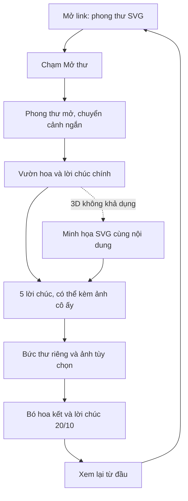

# Workflow trải nghiệm và triển khai

## 1. Luồng người xem

Người xem cuộn dọc tự do sau mở thư. Việc chạm hoa là tùy chọn. Không có bước xem album kỷ niệm, nhận quà bí mật, xác nhận lời hẹn hay gửi thông tin.

## 2. Storyboard năm cảnh

| Cảnh | Nội dung | Hình ảnh và motion | Thao tác |
| --- | --- | --- | --- |
| 01. Phong thư | Tên người nhận, ngày 20.10.2026 | SVG giấy kem, con dấu hoa, sợi chỉ | Mở thư; bật nhạc riêng nếu có |
| 02. Khu vườn | Lời chúc chính | Hoa 3D nở, vài hạt sáng; ảnh chân dung tùy chọn nằm trong HTML | Cuộn tiếp |
| 03. Lời chúc | 5 lời chúc cá nhân hóa | Ảnh cô ấy cạnh lời chúc, hoa SVG và nét trang trí | Chạm để hoa nở; luôn đọc được lời chúc |
| 04. Bức thư | 180–300 từ, chữ ký | Nền giấy yên, ảnh nhỏ tùy chọn | Đọc, nghe giọng đọc nếu có |
| 05. Kết | Lời chúc cuối, chữ ký | Hoa chuyển thành bó, sợi chỉ thắt nơ | Xem lại từ đầu |

## 3. Nhịp trải nghiệm

- Mở đầu: nhìn thấy phong thư ngay; không chờ toàn bộ ảnh hoặc 3D tải xong.
- Mở thư: khoảng 1.5–2 giây, có thể bỏ qua. Giảm chuyển động thì chuyển gần như tức thời.
- Vườn hoa: animation nở một lần khi vào cảnh, sau đó chuyển động nhỏ.
- Lời chúc: khoảng 5 card, một card mỗi nhịp đọc trên điện thoại. Không bắt người xem giữ màn hình hoặc kéo một vật thể để đọc chữ.
- Bức thư: chuyển động nền gần như dừng; các đoạn hiện nhanh theo cuộn, không gõ từng ký tự.
- Kết: animation bó hoa khoảng 1.5–2.5 giây, tự hiện khi tới cảnh; không thêm nút “mở bất ngờ”.
- Xem lại: dừng/tua lại timeline, xóa trạng thái hoa đã mở, về intro và đưa focus tới nút mở thư. Nếu nhạc đang bật, giữ lựa chọn âm thanh nhưng không tạo thêm audio instance.

## 4. Quy tắc ảnh đi cùng lời chúc

Ảnh là chân dung hoặc khoảnh khắc riêng của cô ấy, không được biến thành một album kỷ niệm mới.

- Desktop: card hai cột, ảnh và chữ thay đổi vị trí có kiểm soát.
- Mobile: ảnh trên, lời chúc dưới; chữ không đè lên khuôn mặt.
- Mỗi card tối đa một ảnh. Có thể dùng 3 ảnh cho 5 lời chúc; card không ảnh dùng hoa SVG.
- Hero có thể dùng thêm một ảnh nếu bố cục thoáng; không bắt buộc dùng ảnh ở mọi cảnh.
- Bức thư có thể có một ảnh nhỏ trước chữ ký hoặc cạnh lời mở đầu.
- Không gắn ngày kỷ niệm, mốc hẹn hò, địa điểm hoặc lời kể không được người dùng cung cấp.
- Không cần lightbox trong bản đầu; ưu tiên đọc lời chúc trên trang.

## 5. Workflow triển khai

### Giai đoạn A — nền và dữ liệu

1. Task0_1: dự án chạy được, có HTML cho năm section.
2. Task0_2: cấu hình nội dung, xử lý ảnh tùy chọn, nội dung mẫu rõ ràng.
3. Task0_3: thống nhất màu, font, spacing, SVG và responsive cơ bản.

Điểm kiểm tra: đã đọc được toàn bộ trang với nội dung mẫu trước khi thêm 3D.

### Giai đoạn B — hoàn thiện từng cảnh

4. Task0_4: mở thư, focus, skip, âm thanh tùy chọn.
5. Task0_5: khu vườn, renderer dùng chung, SVG fallback.
6. Task0_6: năm lời chúc, ảnh cô ấy, tương tác hoa.
7. Task0_7: thư, chữ ký, bó hoa kết và xem lại.

Điểm kiểm tra: trải nghiệm xuyên suốt từ intro tới kết, không bị khóa bởi ảnh/nhạc/3D.

### Giai đoạn C — ổn định và bàn giao

8. Task0_8: lifecycle, giảm chuyển động, responsive, hiệu năng.
9. Task0_9: kiểm thử luồng thật, kiểm tra nội dung, build và hướng dẫn.

Điểm kiểm tra: build tĩnh chạy được qua HTTP, đường dẫn ảnh đúng và không còn nội dung mẫu ngoài ý muốn.

## 6. Cách xử lý trường hợp thiếu hoặc lỗi

| Tình huống | Hành vi mong đợi |
| --- | --- |
| Chưa có ảnh | Bố cục hoa và lời chúc đầy đủ |
| Một ảnh bị lỗi | Ẩn ảnh hỏng, giữ lời chúc, không để icon ảnh vỡ |
| Không có nhạc | Không hiện nút nhạc vô tác dụng |
| Trình duyệt từ chối phát nhạc | Nút trở về trạng thái tắt, có thể thử lại |
| Timeline mở thư tải lỗi hoặc quá chậm | Hoàn tất bằng SVG, chuyển sang đọc; không chặn nội dung |
| Three.js tải chậm | Hiện SVG, người xem tiếp tục cuộn |
| WebGL lỗi | Dùng SVG cho vườn và bó hoa |
| Người xem giảm chuyển động | Hiện nội dung và trạng thái hoa hoàn chỉnh, tắt camera parallax |
| Mở anchor ở giữa trang | Hiện section và trạng thái đọc đúng, không bị intro phủ lên |
| Cuộn nhanh tới cuối | Nội dung cuối hiện ngay; không phụ thuộc hoàn thành các animation trước |

## 7. Nội dung chờ cá nhân hóa

Tạm dùng xưng hô anh–em, màu hồng phấn và hoa cách điệu. Các lựa chọn này được thay qua cấu hình khi có thông tin thật. Không cần đợi ảnh để bắt đầu triển khai.

Không thêm vào scope mặc định: tải thiệp, câu đố mật khẩu, đếm ngày yêu, form phản hồi, analytics, upload ảnh, lời hẹn, mở hộp quà. Nếu muốn thêm sau, tạo task riêng để không ảnh hưởng luồng đã chốt.
